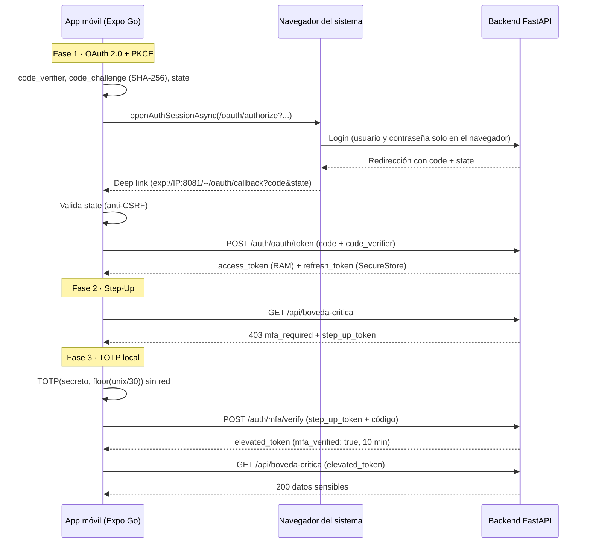

# TOTP — Seguridad Móvil

Aplicación móvil (**React Native / Expo**) y backend (**FastAPI**) que implementan una arquitectura de seguridad completa, escrita sin librerías "caja negra":

| | Qué incluye |
|---|---|
| 🔑 | **OAuth 2.0 Authorization Code + PKCE** (RFC 7636) con el navegador seguro del sistema, nunca una WebView |
| 🔄 | **Silent Refresh Queue**: ante un 401 se hace una sola renovación del token y se reintentan las peticiones en espera |
| 🔢 | **Authenticator TOTP propio** (RFC 6238): SHA-1, HMAC-SHA1 y truncamiento dinámico desde cero; funciona sin internet y da los mismos códigos que Google Authenticator |
| 🔐 | **Step-Up 2FA + Anti-Replay**: la bóveda exige un segundo factor y el backend rechaza códigos reutilizados (`409`) |

Proyecto del curso de **Desarrollo Móvil** · Universidad de La Sabana.

**Integrantes:** _(agrega aquí los nombres)_

---

## Estructura

```
TOTP-Taller/
├── backend-auth/              # Proveedor OAuth + API protegida (FastAPI, en memoria)
│   ├── main.py                # Endpoints
│   ├── security.py            # Tokens HS256, PKCE y TOTP del servidor (sin dependencias)
│   ├── requirements.txt
│   └── tests/test_security.py # Vectores oficiales de RFC 6238 y RFC 7636
└── mobile-app/                # App Expo (TypeScript)
    ├── App.tsx                # Navegación por pestañas
    └── src/
        ├── config.ts          # URL del backend
        ├── api/http.ts        # Cliente HTTP + Silent Refresh Queue
        ├── auth/              # oauth.ts, tokenStore.ts, AuthContext.tsx
        ├── crypto/            # pkce.ts, sha1.ts, hmac.ts, encoding.ts
        ├── totp/              # totp.ts, otpauth.ts, accounts.ts
        ├── screens/           # Welcome, Authenticator, Vault, Session
        └── ui/                # Tema y componentes
```

## Pantallas

- **Bienvenida**: inicio de sesión y acceso directo al Authenticator (que funciona sin cuenta).
- **Authenticator**: lista de cuentas con código de 6 dígitos y barra de tiempo de 30 s. Se agregan escaneando un QR `otpauth://` o pegando la semilla Base32. Mantén presionada una cuenta para eliminarla.
- **Bóveda**: recurso protegido que pide el segundo factor mediante un modal 2FA.
- **Sesión**: datos del usuario y del token, y una prueba de la Silent Refresh Queue.

La interfaz usa un tema claro con acento verde bosque, definido en `mobile-app/src/ui/theme.ts`.

---

## Flujo



### Decisiones de diseño

| Tema | Decisión |
|------|----------|
| Cliente público | No hay `client_secret` en la app; PKCE lo reemplaza |
| Navegador | `WebBrowser.openAuthSessionAsync` (ASWebAuthenticationSession / Custom Tabs). Sin WebViews |
| Deep link en Expo Go | El `redirect_uri` se arma con la dirección de Metro: `exp://<IP>:8081/--/oauth/callback` |
| Anti-CSRF | `state` aleatorio por solicitud; si no coincide al volver, se aborta el intercambio |
| Tokens | `access_token` solo en memoria (5 min). `refresh_token` en `expo-secure-store` (30 días), rotado en cada renovación |
| Silent Refresh | Los 401 se encolan, se renueva **una sola vez**, se reintenta y se libera la cola. Si el refresh falla se limpia SecureStore y se vuelve a Bienvenida |
| TOTP | SHA-1 y HMAC-SHA1 propios. `expo-crypto` solo se usa para PKCE |
| Reloj | El backend acepta las ventanas C-1, C y C+1 |
| Anti-Replay | Caché `(usuario, código)` con TTL de 90 s → `409 Replay Attack Detected` |

---

## Requisitos

- **Node.js** 20 o superior y **npm**
- **Python** 3.10 o superior
- **Expo Go** actualizado en el celular
- PC y celular en la **misma red** (si la red del campus aísla los dispositivos, usa el hotspot del celular)

## Puesta en marcha

### 0. IP local del PC

- Windows: `ipconfig` → *Dirección IPv4* del adaptador **Wi-Fi** (ignora las de VirtualBox, Tailscale y similares)
- macOS: `ipconfig getifaddr en0` · Linux: `hostname -I`

No uses `localhost`: para el celular, `localhost` es él mismo. En los ejemplos se usa `192.168.1.9`; reemplázala por la tuya.

### 1. Backend

```bash
cd backend-auth
python -m venv .venv
.venv\Scripts\activate          # Windows
source .venv/bin/activate       # macOS / Linux

pip install -r requirements.txt
python tests/test_security.py   # opcional: pruebas unitarias
uvicorn main:app --host 0.0.0.0 --port 8000 --reload
```

Credenciales de laboratorio:

| Dato | Valor por defecto |
|------|-------------------|
| Usuario | `estudiante` |
| Contraseña | `unisabana123` |
| Semilla TOTP (Base32) | `JBSWY3DPEHPK3PXP` |

Comprueba desde el navegador **del celular** que `http://192.168.1.9:8000/health` responde `{"ok":true,...}`. En Windows, si no responde, abre el puerto desde PowerShell como administrador:

```powershell
netsh advfirewall firewall add rule name="Backend 8000" dir=in action=allow protocol=TCP localport=8000 profile=any
```

El QR de la semilla está en `http://localhost:8000/mfa/setup` (en el navegador del PC; carga una librería de QR desde internet).

### 2. App móvil

```bash
cd mobile-app
npm install
```

Crea el archivo `mobile-app/.env` con la IP de tu PC:

```
EXPO_PUBLIC_API_URL=http://192.168.1.9:8000
```

Arranca Expo fijando la IP para que el deep link de regreso sea correcto:

```powershell
$env:REACT_NATIVE_PACKAGER_HOSTNAME="192.168.1.9"     # Windows PowerShell
npx expo start -c
```

macOS / Linux: `REACT_NATIVE_PACKAGER_HOSTNAME=192.168.1.9 npx expo start -c`

La terminal debe mostrar `Metro: exp://192.168.1.9:8081`. Cierra Expo Go por completo y escanea el QR (Android: desde Expo Go; iPhone: con la cámara).

### Variables opcionales del backend

El backend lee **variables de entorno de la terminal** (no carga el `.env` solo):

```powershell
$env:ACCESS_TTL_SECONDS="20"      # ver expirar el token en 20 s
uvicorn main:app --host 0.0.0.0 --port 8000 --reload
```

Disponibles: `ACCESS_TTL_SECONDS` (300), `ELEVATED_TTL_SECONDS` (600), `JWT_SECRET`, `DEMO_USER`, `DEMO_PASSWORD`, `TOTP_SECRET`. Si cambias `TOTP_SECRET`, usa la misma semilla al agregar la cuenta en el Authenticator.

---

## Endpoints del backend

| Método | Ruta | Función |
|--------|------|---------|
| GET / POST | `/oauth/authorize` | Login en el navegador; valida `code_challenge` (S256) y redirige con `code` + `state` |
| POST | `/auth/oauth/token` | Canjea `code` + `code_verifier` |
| POST | `/auth/refresh` | Renueva el `access_token` (rota el `refresh_token`) |
| POST | `/auth/logout` | Revoca el `refresh_token` |
| GET | `/api/perfil` | Recurso protegido simple (prueba del 401 y del Silent Refresh) |
| GET | `/api/boveda-critica` | `403 mfa_required` + `step_up_token` si `mfa_verified` es `false` |
| POST | `/auth/mfa/verify` | Valida el TOTP en C-1/C/C+1; anti-replay 90 s → `409`; devuelve `elevated_token` (10 min) |
| GET | `/mfa/setup` | Página con el QR y la semilla |
| GET | `/health` | Estado del servicio |

---

## Pruebas de aceptación

Preparación: backend y app corriendo, y la cuenta agregada en la pestaña **Authenticator** (*Pegar semilla* con `JBSWY3DPEHPK3PXP`, o escaneando el QR de `/mfa/setup`).

| # | Prueba | Procedimiento | Resultado esperado |
|---|--------|---------------|--------------------|
| 1 | OAuth + PKCE | **Iniciar sesión** → login en el navegador → volver a la app (si no regresa sola, tocar el enlace de la página y elegir Expo Go) | La app recibe el callback sin ver credenciales |
| 2 | Paridad TOTP | Escanear el mismo QR en la app y en Google Authenticator | Los mismos 6 dígitos al mismo tiempo |
| 3 | Cálculo offline | Modo Avión y esperar a que la barra llegue a 0 | El código se regenera sin red |
| 4 | Step-Up | Pestaña **Bóveda** → modal 2FA → ingresar el código | Acceso solo tras verificar el segundo factor |
| 5 | Anti-Replay | Con la bóveda abierta, **Probar Anti-Replay** | `HTTP 409 → Replay Attack Detected` |
| 6 | Silent Refresh | Pestaña **Sesión** → **Simular token expirado** | 3 peticiones devuelven 200 con **1** sola renovación |

---

## Solución de problemas

| Síntoma | Causa y solución |
|---------|------------------|
| `Network request failed` | IP incorrecta en `mobile-app/.env`, backend sin `--host 0.0.0.0`, firewall en el puerto 8000 o red que aísla dispositivos (usa el hotspot). Reinicia con `npx expo start -c` tras cambiar el `.env` |
| La IP cambió | Repite `ipconfig`, actualiza `mobile-app/.env` y el comando de Expo |
| El login no regresa a la app | Toca el enlace de la página y elige Expo Go. Verifica que Metro diga `exp://<IP>:8081` y no `localhost` |
| `Project is incompatible with this version of Expo Go` | El SDK del proyecto no coincide con tu Expo Go: actualiza Expo Go |
| El código no coincide con Google Authenticator | Activa la fecha y hora automáticas del celular |
| `ModuleNotFoundError: fastapi` | No activaste el entorno virtual |
| `pip.exe` o `uvicorn.exe` bloqueados (Windows) | Una directiva de Control de aplicaciones bloquea ejecutables. Usa `python -m pip ...` y `python -m uvicorn ...` |
| `DLL load failed while importing _pydantic_core` | La misma política bloquea el módulo compilado de pydantic 2. Usa pydantic 1, que se instala en Python puro: ver abajo |

### Windows con Control de aplicaciones: backend sin módulos compilados

```powershell
python -m venv C:\totp-venv
C:\totp-venv\Scripts\python.exe -m pip install "fastapi==0.99.1" uvicorn python-multipart
C:\totp-venv\Scripts\python.exe -m pip install "pydantic==1.10.13" --no-binary pydantic --force-reinstall --no-deps
C:\totp-venv\Scripts\python.exe -c "import pydantic; print(pydantic.compiled)"   # debe imprimir False

cd backend-auth
C:\totp-venv\Scripts\python.exe -m uvicorn main:app --host 0.0.0.0 --port 8000
```

---

## Notas de seguridad

Es un laboratorio, no un sistema de producción:

- El backend guarda todo **en memoria**: al reiniciarlo se pierden los refresh tokens.
- Usa **HTTP sin TLS**. En producción: HTTPS, secretos en un gestor y almacenamiento persistente.
- No hay límite de intentos en `/auth/mfa/verify`; en producción convendría añadirlo.
- Las credenciales y la semilla de este README son **datos de demostración**.
