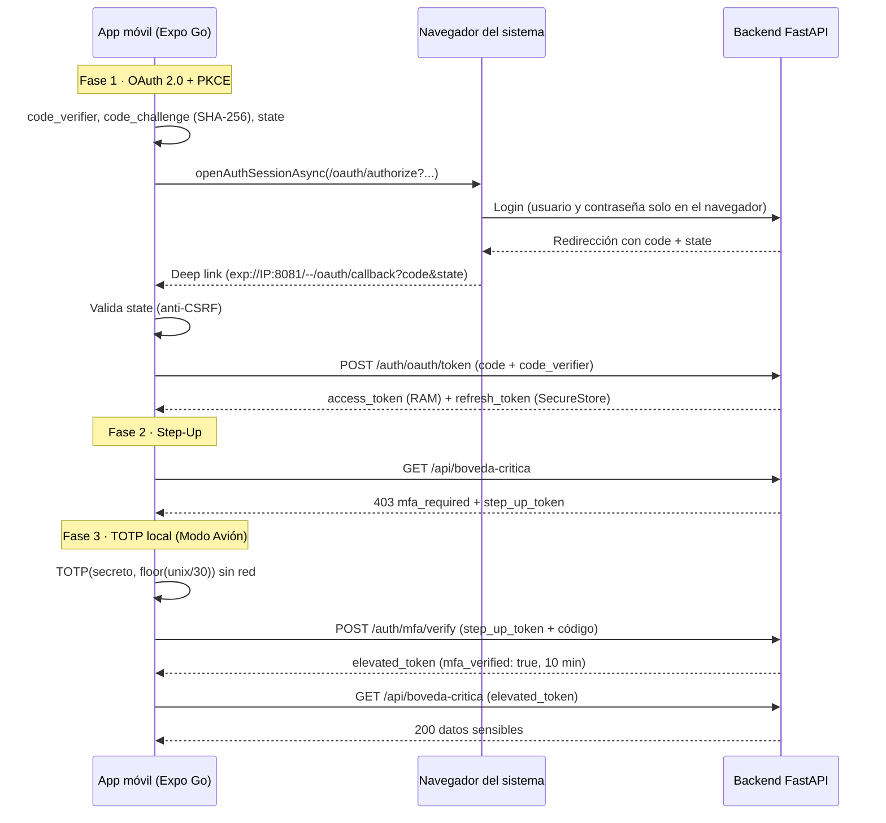

# TOTP — Seguridad Móvil: OAuth 2.0 con PKCE, Silent Refresh y Step-Up 2FA

Laboratorio de **Desarrollo Móvil (React Native / Expo)** · Universidad de La Sabana · Facultad de Ingeniería · Sesión 14

Aplicación móvil en **Expo Go** y backend en **FastAPI** que implementan, sin librerías "caja negra", una arquitectura de seguridad móvil completa:

1. **OAuth 2.0 Authorization Code + PKCE (RFC 7636)** con el navegador seguro del sistema (nunca una WebView).
2. **Almacenamiento seguro y Silent Refresh Queue**: `access_token` en RAM, `refresh_token` en Keychain/Keystore.
3. **Authenticator TOTP propio (RFC 6238)**: SHA-1, HMAC-SHA1 y truncamiento dinámico escritos desde cero; funciona en Modo Avión y da los mismos códigos que Google Authenticator.
4. **Step-Up Authentication + Anti-Replay**: la bóveda exige un segundo factor y el backend rechaza códigos reutilizados (409).

> **Integrantes:** _(completa aquí tu nombre / equipo)_

---

## Estructura del repositorio

```
TOTP/
├── backend-auth/              # Proveedor OAuth + API protegida (FastAPI, en memoria)
│   ├── main.py                # Endpoints
│   ├── security.py            # Tokens HS256, PKCE y TOTP del servidor (sin dependencias)
│   ├── requirements.txt
│   ├── .env.example
│   └── tests/test_security.py # Vectores oficiales RFC 6238 y RFC 7636
├── mobile-app/                # App Expo (TypeScript)
│   ├── App.tsx
│   ├── .env.example
│   └── src/
│       ├── config.ts
│       ├── api/http.ts            # Cliente HTTP + Silent Refresh Queue
│       ├── auth/                  # oauth.ts, tokenStore.ts, AuthContext.tsx
│       ├── crypto/                # pkce.ts, sha1.ts, hmac.ts, encoding.ts
│       ├── totp/                  # totp.ts, otpauth.ts, accounts.ts
│       ├── screens/               # Welcome, Authenticator, Vault, Session
│       └── ui/                    # Tema y componentes
└── README.md
```

---

## Arquitectura y flujo



### Decisiones de diseño relevantes

| Tema | Decisión |
|------|----------|
| Cliente público | No existe `client_secret` en la app; PKCE lo reemplaza |
| Navegador | `WebBrowser.openAuthSessionAsync` (ASWebAuthenticationSession / Custom Tabs). Sin WebViews |
| Deep link en Expo Go | El `redirect_uri` se arma con la dirección de Metro: `exp://<IP>:8081/--/oauth/callback`. En un build propio se usa el esquema `unisabana-auth://` |
| Anti-CSRF | `state` aleatorio por solicitud; si no coincide al volver, se aborta el intercambio |
| Tokens | `access_token` solo en memoria (5 min). `refresh_token` en `expo-secure-store` (30 días), rotado en cada renovación |
| Silent Refresh | Ante un 401 las peticiones se encolan, se hace **una sola** renovación, se reintenta y se libera la cola. Si el refresh falla: se limpia SecureStore y se vuelve a Bienvenida |
| TOTP | SHA-1 y HMAC-SHA1 propios (síncronos). `expo-crypto` solo se usa para PKCE (SHA-256 y aleatorios). Probado con los vectores oficiales de RFC 6238 |
| Reloj | Tolerancia de desfase en el backend: ventanas C-1, C y C+1 |
| Anti-Replay | Caché `(usuario, código)` con TTL de 90 s, protegida con lock → `409 Replay Attack Detected` |

---

## Requisitos

- **Node.js LTS** (v20 o superior) y **npm**
- **Python 3.10 o superior**
- **Git**
- **Expo Go** en el celular, en su versión más reciente (el SDK del proyecto debe coincidir con el que soporta tu Expo Go; ver `mobile-app/package.json`)
- **Google Authenticator** (solo para la prueba de paridad)
- PC y celular en la **misma red Wi-Fi**

---

## Puesta en marcha

### 0. Averiguar la IP local del PC
- Windows: `ipconfig` → *Dirección IPv4* del adaptador **Wi-Fi** (ignora las de VirtualBox, como `192.168.56.1`)
- macOS: `ipconfig getifaddr en0` · Linux: `hostname -I`

No uses `localhost`: para el celular, `localhost` es él mismo. En los ejemplos se usa `192.168.1.9`; reemplázala por la tuya.

### 1. Backend

```bash
cd backend-auth
python -m venv .venv

# Activar el entorno
.venv\Scripts\activate          # Windows
source .venv/bin/activate       # macOS / Linux

pip install -r requirements.txt

# (opcional) pruebas unitarias
python tests/test_security.py

# Escuchar en toda la red local (necesario para el celular)
uvicorn main:app --host 0.0.0.0 --port 8000 --reload
```

Al arrancar aparece un banner con las credenciales de laboratorio:

| Dato | Valor por defecto |
|------|-------------------|
| Usuario | `estudiante` |
| Contraseña | `unisabana123` |
| Semilla TOTP (Base32) | `JBSWY3DPEHPK3PXP` |

Comprueba desde el navegador **del celular**: `http://192.168.1.9:8000/health` debe responder `{"ok":true,...}`.
En Windows, si no responde, abre PowerShell como administrador y ejecuta:

```
netsh advfirewall firewall add rule name="Backend 8000" dir=in action=allow protocol=TCP localport=8000 profile=any
```

QR de la semilla (para escanear con la app y con Google Authenticator): `http://localhost:8000/mfa/setup` en el navegador del PC.

> Si `pip install` falla en Windows por `pyyaml` (suele pasar con versiones muy nuevas de Python), instala solo lo necesario: `pip install fastapi uvicorn python-multipart`.

### 2. App móvil

```bash
cd mobile-app
npm install
cp .env.example .env            # Windows: copy .env.example .env
```

Edita `mobile-app/.env` con la IP de tu PC:

```
EXPO_PUBLIC_API_URL=http://192.168.1.9:8000
```

Arranca Expo (en PowerShell, fijando la IP para que el deep link de regreso sea correcto):

```powershell
$env:REACT_NATIVE_PACKAGER_HOSTNAME="192.168.1.9"
npx expo start -c
```

macOS / Linux: `REACT_NATIVE_PACKAGER_HOSTNAME=192.168.1.9 npx expo start -c`.

Verifica que la terminal muestre `Metro: exp://192.168.1.9:8081`, cierra Expo Go por completo y escanea el QR (Android: desde Expo Go; iPhone: con la cámara).

### Variables opcionales del backend

El backend lee **variables de entorno de la terminal** (no carga el `.env` solo). Ejemplo para ver expirar el token en 20 s:

```powershell
$env:ACCESS_TTL_SECONDS="20"      # Windows PowerShell
uvicorn main:app --host 0.0.0.0 --port 8000 --reload
```

Disponibles: `ACCESS_TTL_SECONDS` (300), `ELEVATED_TTL_SECONDS` (600), `JWT_SECRET`, `DEMO_USER`, `DEMO_PASSWORD`, `TOTP_SECRET`. Si cambias `TOTP_SECRET`, usa la misma semilla al agregar la cuenta en el Authenticator.

---

## Endpoints del backend

| Método | Ruta | Función |
|--------|------|---------|
| GET / POST | `/oauth/authorize` | Login en el navegador del sistema; valida `code_challenge` (S256) y redirige con `code` + `state` |
| POST | `/auth/oauth/token` | Canjea `code` + `code_verifier`; verifica `SHA256(verifier) == challenge` |
| POST | `/auth/refresh` | Renueva el `access_token` (rota el `refresh_token`) |
| POST | `/auth/logout` | Revoca el `refresh_token` |
| GET | `/api/perfil` | Recurso protegido simple (prueba del 401 y del Silent Refresh) |
| GET | `/api/boveda-critica` (alias `/api/boveda`) | `403 mfa_required` + `step_up_token` si `mfa_verified` es `false` |
| POST | `/auth/mfa/verify` | Valida TOTP en C-1/C/C+1; anti-replay 90 s → `409`; devuelve `elevated_token` (10 min) |
| GET | `/mfa/setup` | Página con el QR y la semilla (laboratorio) |
| GET | `/health` | Estado del servicio |

---

## Pruebas de aceptación (sustentación)

Preparación: backend y app corriendo; en la pestaña **Authenticator** agrega la cuenta con la semilla `JBSWY3DPEHPK3PXP` (*Pegar semilla*) o escaneando el QR de `/mfa/setup`.

| # | Prueba | Procedimiento | Resultado esperado |
|---|--------|---------------|--------------------|
| 1 | OAuth + PKCE con navegador del sistema | **Iniciar sesión** → login en el navegador → volver por deep link (si no regresa sola, tocar *"Toca aquí si no regresa automáticamente"* y elegir Expo Go) | La app recibe el callback sin ver credenciales y guarda el `refresh_token` en SecureStore |
| 2 | Paridad TOTP | Escanear el mismo QR en la app y en Google Authenticator | Ambas muestran los mismos 6 dígitos al mismo tiempo |
| 3 | Cálculo offline | Activar Modo Avión y esperar a que la barra llegue a 0 | El código se regenera sin red ni errores |
| 4 | Step-Up y bóveda | Pestaña **Bóveda** → modal 2FA → ingresar el código | Acceso solo después de verificar el segundo factor |
| 5 | Anti-Replay | Con la bóveda abierta, **Probar Anti-Replay** | `HTTP 409 → Replay Attack Detected` |
| Extra | Silent Refresh | Pestaña **Sesión** → **Simular token expirado** | 3 peticiones en paralelo devuelven 200 con **1** sola renovación |

---

## Qué archivo demuestra cada punto

| Punto de la rúbrica | Archivos |
|---------------------|----------|
| TOTP desde cero (RFC 6238) | `mobile-app/src/crypto/sha1.ts`, `hmac.ts`, `src/totp/totp.ts` |
| OAuth 2.0 + PKCE + deep linking | `src/crypto/pkce.ts`, `src/auth/oauth.ts`, `backend-auth/main.py` |
| Almacenamiento seguro + Silent Refresh | `src/auth/tokenStore.ts`, `src/api/http.ts` |
| Step-Up + Anti-Replay | `src/screens/VaultScreen.tsx`, `backend-auth/main.py` |
| UI/UX y código limpio | `src/screens/*`, `src/ui/*` (TypeScript estricto, módulos separados) |

---

## Solución de problemas

| Síntoma | Causa y solución |
|---------|------------------|
| `Network request failed` | IP incorrecta en `mobile-app/.env`, backend sin `--host 0.0.0.0`, firewall en el puerto 8000 o Wi-Fi que aísla dispositivos (usa el hotspot del celular). Reinicia con `npx expo start -c` tras cambiar el `.env` |
| La IP cambió | Repite `ipconfig`, actualiza `mobile-app/.env` y el comando de Expo |
| El login no regresa a la app | Toca el enlace de la página y elige Expo Go. Verifica que Metro diga `exp://<IP>:8081` y no `localhost` |
| `Linking requires a build-time setting scheme` | El proyecto usa un `redirect_uri` armado a mano para Expo Go; confirma que `src/auth/oauth.ts` es la versión que usa `expo-constants` |
| `Project is incompatible with this version of Expo Go` | El SDK del proyecto no coincide con el de tu Expo Go: actualiza Expo Go o el SDK |
| El código no coincide con Google Authenticator | Activa la fecha y hora automáticas del celular |
| `ModuleNotFoundError: fastapi` | No activaste el entorno virtual `.venv` |

---

## Notas de seguridad

Es un laboratorio, no un sistema de producción:

- El backend guarda todo **en memoria**: al reiniciarlo se pierden los refresh tokens.
- Usa **HTTP sin TLS**. En producción: HTTPS, secretos en un gestor y almacenamiento persistente.
- No hay límite de intentos en `/auth/mfa/verify`; en producción convendría añadirlo.
- Las credenciales y la semilla del README son **datos de demostración**.

## Video demostrativo

https://drive.google.com/file/d/1XYHznKQIAnDeXf454NaizYn5JZ1DHx-0/view?usp=sharing

